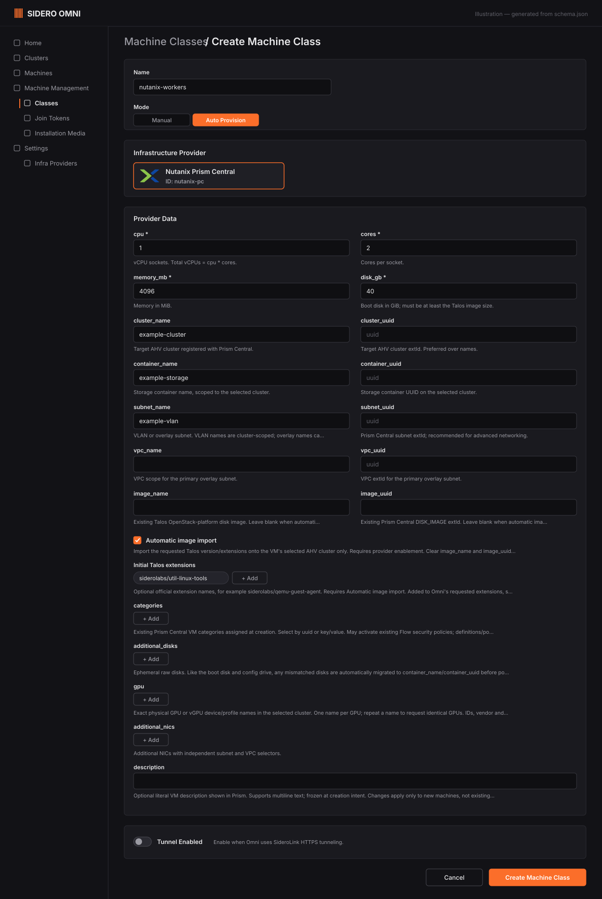

# MachineClass configuration

Create a MachineClass in Omni targeting provider ID **`nutanix-pc`**. Its provider
data describes a **new allocation**, not a mutable VM specification. Submitted
creation/image/storage intent is frozen; editing a class does not update existing
machines. Example resources are in [`deploy/examples/`](../deploy/examples/).



*Illustration, not a screenshot: the fields and help text come from the provider's
[schema](../cmd/omni-infra-provider-nutanix/data/schema.json), filled with the
quickstart's example values. Layout and styling in your Omni version may differ.*

## Required sizing and placement

| Field | Meaning |
| --- | --- |
| `cpu` | CPU sockets, at least 1. Total vCPUs = `cpu * cores`. |
| `cores` | Cores per socket, at least 1. |
| `memory_mb` | Memory in MiB, at least 512. Choose a size appropriate for Talos/Kubernetes. |
| `disk_gb` | Boot disk in GiB, at least 5 and no smaller than the image. |
| `cluster_name` / `cluster_uuid` | Target registered AHV cluster. |
| `container_name` / `container_uuid` | Required destination storage container in that cluster. |
| `subnet_name` / `subnet_uuid` | Primary VLAN/overlay guest subnet. |
| `image_name` / `image_uuid` | Manual Talos OpenStack DISK_IMAGE, unless automatic import is enabled. |

Use at least one selector in each required pair. Prefer UUIDs for stable placement;
names must resolve unambiguously in the selected scope. When both name and UUID are
supplied, they must refer to the same object. Use the Prism Central origin, not a
Prism Element endpoint, in the provider's runtime configuration.

Manual images must support UEFI, match the requested Talos version/extensions and
be available in the selected cluster. To use Factory instead, set `image_import: true`,
clear both manual image selectors and enable provider-wide `IMAGE_IMPORT_ENABLED`.
Optional `initial_extensions` are official names without tags/digests. See
[images and extensions](image-import.md).

## Storage and boot

New VMs use UEFI, disk/CDROM/network boot order and Secure Boot disabled. A destination
container preference on an image clone is not a placement guarantee. Before first
power-on, the provider verifies every required backing disk and migrates mismatched
boot/data/generated config-drive disks to the destination container. Missing metadata,
in-flight migration or changed inventory blocks power-on rather than dropping a disk
or changing guest media.

Optional raw disks:

```yaml
additional_disks:
  - size: 100
  - size: 200
```

Each size is GiB, at least 1; the list is bounded to 1023 entries. All disks are
**ephemeral**: deleted with the VM and not preserved on replacement. Storage placement
cannot be disabled for new requests; do not add retired `migrate_disks` fields.

## Networking

For VLAN-backed guests, omit VPC selectors. Overlay guest subnets can use
`vpc_name`/`vpc_uuid` to narrow the primary subnet selection. External VPC uplinks are
not guest networks. Additional NICs have independent subnet/VPC selectors:

```yaml
additional_nics:
  - subnet_name: example-secondary-vlan
  - subnet_name: example-overlay
    vpc_name: example-vpc
```

The provider attaches to existing networks. It does not configure subnets, DHCP,
DNS, NAT, routes, floating IPs or VLAN trunks. Guest routing/default routes and Flow
rules must permit Omni bootstrap and intended cluster traffic. When Omni uses HTTPS
SideroLink tunneling, select **Tunnel Enabled** in the MachineClass.

## Prism categories and VM descriptions

Select existing category definitions by UUID or key/value, up to 256 entries:

```yaml
description: "Omni-managed Talos node"
categories:
  - key: AppType
    value: Kubernetes
  - key: Environment
    value: Development
```

These fictional definitions must exist in your environment. Categories can activate
existing Flow security policies; the provider does not create/update categories or
policies. Provisioning permissions must also authorize category use in VM creation.

`description` is optional literal text, up to 2048 Unicode characters. It supports
multiline values, has no template expansion, is frozen for creation/replay and does
not update an existing VM.

## GPU profiles

Use exact, case-sensitive physical GPU/vGPU catalog names in the selected cluster:

```yaml
gpu:
  - "<exact-profile-name>"
```

One entry requests one GPU; repeat names to request identical GPUs. At most 16 names,
128 bytes each, without control characters. Names must resolve unambiguously across
the physical and virtual catalogs. The provider freezes the resolved device ID,
vendor and mode; it does not choose another profile or omit GPUs on failure.

Prism/AHV enforce availability and placement; catalog visibility is not a capacity
reservation. Configure Talos GPU extensions/drivers and Kubernetes device plugins
separately. Read/use permissions are described in [Prism permissions](prism-permissions.md).
Do not use the retired explicit-ID `gpus` field in new classes.
